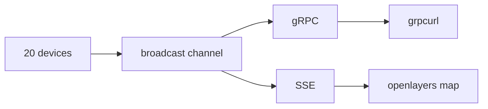

# Telemetry: Streaming gRPC/SSE to Map (Rust/Tokio)
2026-11-10

I wanted a small project to practise streaming data in Rust, and also to learn Protobufs. 20 simulated drone-like devices which report their position twice a second. With one rust server that streams this in two formats: gRPC (tonic), and Server Sent Events (SSE because there is no native gRPC for browsers). The map below is a live demo of this:

## Try it for yourself:

The map above is an iframe of the [Live map](https://telemetry.jakedrw.com/), so on the full site you can easily move around and zoom. It's a docker container built from [Source (GitHub)](https://github.com/jakedrew/telemetry).

In your terminal using a grpc client (I chose [grpcurl](https://github.com/fullstorydev/grpcurl)) run:

```bash
grpcurl -d '{"id": "SIM-1"}' telemetry.jakedrw.com:443 telemetry.TelemetryService/Telemetry
```

and you'll see a stream of messages like this:

```json
{
  "id": "SIM-1",
  "sequenceNumber": "2373697",
  "latitude": 50.63460873872809,
  "longitude": -1.3539654600872957,
  "altitude": 5
}
{
  "id": "SIM-1",
  "sequenceNumber": "2373698",
  "latitude": 50.63460873872809,
  "longitude": -1.3529954276367737,
  "altitude": 5
}
{
  "id": "SIM-1",
  "sequenceNumber": "2373699",
  "latitude": 50.635641801053275,
  "longitude": -1.3529954276367737,
  "altitude": 5
}
{
  "id": "SIM-1",
  "sequenceNumber": "2373700",
  "latitude": 50.63667486337846,
  "longitude": -1.3529954276367737,
  "altitude": 5
}
```

Leave out the id (or send it empty) and you get every device.

## How it works



Each device is its own tokio task - they all send into one `tokio::sync::broadcast` channel (buffer of 256). Anything that wants the data just subscribes to this channel.

For gRPC: every client gets its own subscription plus a small `mpsc` channel (16) that feeds the response stream. If you pass an id I only forward that device, otherwise you get all of them. A slow client only blocks its own task, and when it disconnects the send fails and the task ends.

For SSE: I have one bridge task that turns each message into JSON once and puts it on a second broadcast channel (also 256) then each browser subscribes to that with `BroadcastStream`. Browsers can't do gRPC without a grpc-web proxy though, and SSE just works with `EventSource`, which also reconnects on its own.

I also turned on server reflection (where requesting client can discover the services/methods), so grpcurl can list and call the service without you needing the `.proto` definition file.

The message itself is pretty simple:

[Github jakedrew/telemetry proto/telemetry.proto](https://github.com/jakedrew/telemetry/blob/d4b210a44ca1807c16cbc232a637e872aa5e8ad7/proto/telemetry.proto)
```proto
syntax = "proto3";
package telemetry;

message TelemetryResponse {
  string id = 1;
  uint64 sequence_number = 2;
  double latitude = 3;
  double longitude = 4;
  double altitude = 5;
}

message TelemetryRequest {
  optional string id = 1;
}

service TelemetryService {
  rpc Telemetry (TelemetryRequest) returns (stream TelemetryResponse);
}
```

Each message is about 40 bytes as protobuf and about 120 as JSON, mostly because the doubles get written out in full. 20 devices at 2 Hz is 40 messages a second, so roughly 5 KB/s per browser.

If anything gets more than 256 messages behind, tokio gives it a `Lagged` error, and I just skip what was missed and carry on from the latest. With gRPC you'll see a jump in `sequence_number`, and on the map the device jumps forward, so a tab that's been asleep picks straight back up.

## Faking the devices

It's centred on the Isle of Wight, mainly because a recognisable location and at this zoom the water made the embedded map look less bland than centering over land.

The devices start in a 10 km square split into a grid where there is one device per cell so they don't all bunch up. Each one then drives a square with a random size (0.005–0.02°), random speed (0.0003–0.002° per tick), and ticking every 500 ms. 

## Hosting

The container runs the Rust binary and a Caddy on :2190 serving the map from `/srv`. If either one dies the whole container exits so docker can restart it. My [jakedrw.com](https://jakedrw.com) Caddy sits in front and does TLS. gRPC (and reflection) goes to tonic, `/stream` goes to axum, and everything else goes to the internal Caddy.
